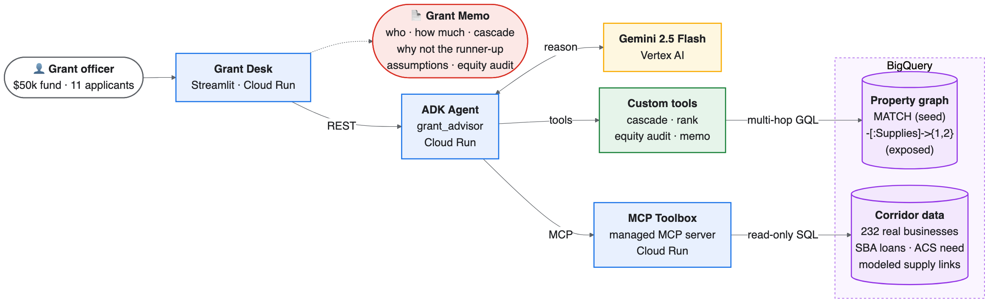
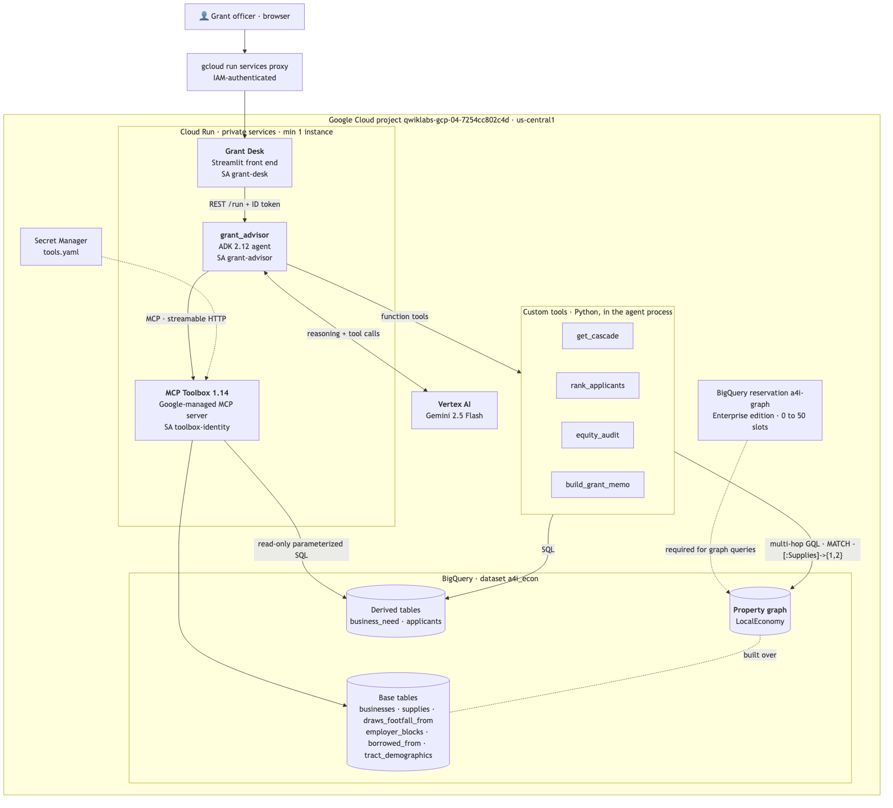
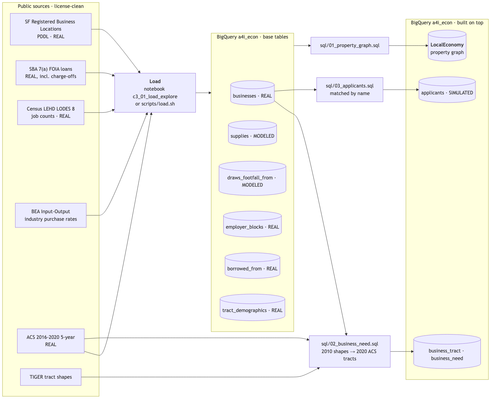
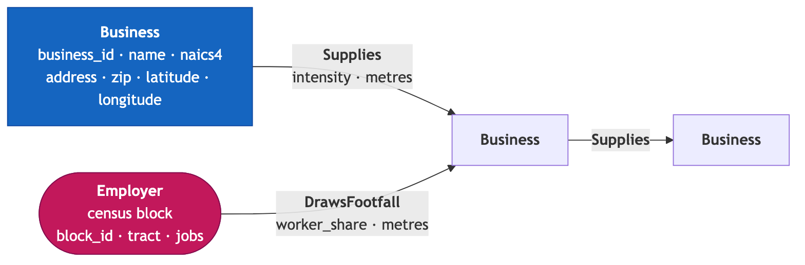
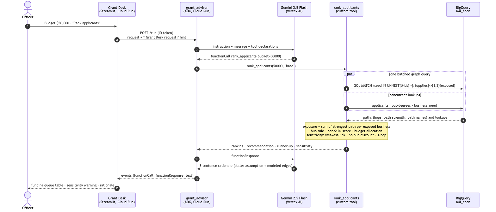

# Architecture: Grant Advisor (Team TRT3, Challenge 3)

**Track:** 🏢 Main Street relief · **Corridor:** Central Market, San Francisco ·
**Project:** `qwiklabs-gcp-04-7254cc802c4d` (us-central1)

A grant officer sets a budget in the **Grant Desk**. The **ADK agent** (Gemini 2.5 Flash) decides
which tools to call. The custom tools walk the corridor's **BigQuery property graph** with a
multi-hop GQL `MATCH`, turn the paths into a defended ranking and a 7-section **Grant Memo**, and
the **MCP Toolbox** serves read-only lookups. Everything runs as private Cloud Run services.

Diagram sources: [`diagrams/`](diagrams/) (Mermaid). Rendered PNG/SVG for the deck: [`images/`](images/).

## 0. Slide version (for the pitch deck)



Blue = Cloud Run services · yellow = Gemini · green = our custom tools · purple = BigQuery (property
graph + corridor data) · red = the output an officer takes to Friday's meeting.
Source: [`diagrams/00-presentation.mmd`](diagrams/00-presentation.mmd), rendered with
`npx -y @mermaid-js/mermaid-cli@11 -c diagrams/mermaid-slide.config.json -i diagrams/00-presentation.mmd -o images/00-presentation.png -b white -s 3`.

## 1. System architecture



| Component | Runs on | Identity | Role |
|---|---|---|---|
| **Grant Desk** ([`frontend/grant_desk`](../frontend/grant_desk/)) | Cloud Run `grant-desk` | SA `grant-desk` (`run.invoker`) | Officer UI. Draws the queue, cascade picture and memo **from the agent's own tool responses** |
| **grant_advisor** ([`agent/grant_advisor`](../agent/grant_advisor/)) | Cloud Run `grant-advisor` (ADK 2.12) | SA `grant-advisor` (Vertex AI user, BigQuery jobUser + dataViewer) | Gemini 2.5 Flash routes requests, calls tools, writes the rationale; enforces judgment rules (state assumptions, refuse to invent cascades) |
| **Custom tools** | in the agent process | same | `get_cascade` (multi-hop GQL), `rank_applicants` (judgment, allocation, sensitivity), `equity_audit`, `build_grant_memo` |
| **MCP Toolbox 1.14** ([`toolbox/tools.yaml`](../toolbox/tools.yaml)) | Cloud Run `toolbox` | SA `toolbox-identity` | **Google-managed MCP server**: `find_business`, `list_applicants`, `get_neighborhood`, `get_loan_history`, `corridor_industry_mix` (curated, read-only, parameterized) |
| **Gemini 2.5 Flash** | Vertex AI | n/a | Reasoning + prose; temperature 0.2 |
| **BigQuery `a4i_econ`** | BigQuery (US) | n/a | Base tables, `LocalEconomy` property graph, `business_need`, `applicants` |
| **Reservation `a4i-graph`** | BigQuery Reservations | n/a | Enterprise edition, 0 baseline → 50 autoscale slots; required for graph queries |
| **Secret `tools`** | Secret Manager | n/a | Toolbox config, mounted at `/app/tools.yaml` |

**Split of responsibilities (design decision D6):** generic lookups go through the managed MCP
server; the *judgment* (what counts as exposure, how to weight a path, what a grant changes) lives in
custom tools that are unit-tested.

## 2. Data pipeline: what is real and what is modeled



| Layer | Objects | Built by |
|---|---|---|
| Real | businesses, borrowed_from (SBA loans incl. charge-offs), employer_blocks (LEHD jobs), tract_demographics + business_need (ACS) | notebook / `load.sh`, `sql/02` |
| **Modeled** | `supplies` (BEA industry rates assigned to nearby pairs), `draws_footfall_from` (LEHD jobs allocated to nearby shops) | notebook / `load.sh` |
| **Simulated** | `applicants` (11 applications from real businesses) | `sql/03` |
| Graph | `LocalEconomy` over businesses, employer_blocks, supplies, draws_footfall_from | `sql/01` |

Re-run `sql/01` → `sql/03` after **every** reload (IDs differ between notebook and `load.sh`). See
[DATA_SOURCES.md](DATA_SOURCES.md).

## 3. Graph model



Arrows point from the business **depended upon** to the one that **depends** on it. Following
`Supplies` forward traces exposure. `get_cascade` uses `-[e:Supplies]->{1,2}`; path strength is the
product of `intensity` along the path, computed in GQL with horizontal aggregation
(`EXP(SUM(LN(e.intensity)))`).

## 4. One request end to end: "Rank applicants"



Measured on the deployed services with real data (2026-10-20): **≈2.5 s** per Grant Desk action warm.
`rank_applicants` takes 4.5 s cold (first call per instance or after the 10-minute data-cache TTL),
then ≈0 s, because all applicants' cascades come from **one** batched GQL query.

## 5. Security and operations

- All three services are **private** (`--no-allow-unauthenticated` for the agent and desk). People
  reach them through `gcloud run services proxy`, service-to-service calls use ID tokens, and every
  service has its own least-privilege service account.
- Toolbox exposes only fixed, parameterized, read-only queries (no free-form SQL from the LLM).
- Infrastructure is code: [`terraform/`](../terraform/) (APIs, service accounts, IAM, secret,
  Toolbox) with state in `gs://qwiklabs-gcp-04-7254cc802c4d-tfstate`. Deploys:
  [`scripts/deploy_agent.sh`](../scripts/deploy_agent.sh), [`scripts/deploy_desk.sh`](../scripts/deploy_desk.sh).
- Min 1 instance on each service, so no cold starts on stage.

## 6. Known limitations (say them in the deck)

- Two of three edge types are **modeled**; recommendations are only as good as the BEA-based allocation.
- Need data for split census tracts is the average over the old (2010) tract area.
- Applications are simulated; there is no per-business jobs data anywhere in public US data.
- A grant changes a probability, not an outcome; the 10-point closure-risk reduction is an assumption,
  and the memo shows how the answer moves under 5 and 20 points.

## Regenerate the images

```bash
cd docs
for f in diagrams/*.mmd; do n=$(basename "$f" .mmd)
  npx -y @mermaid-js/mermaid-cli@11 -i "$f" -o "images/$n.svg" -b white
  npx -y @mermaid-js/mermaid-cli@11 -i "$f" -o "images/$n.png" -b white -s 2
done
```
