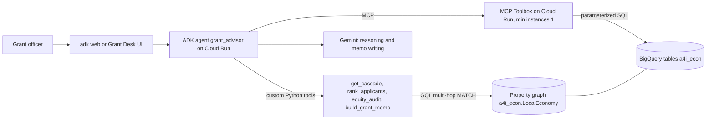
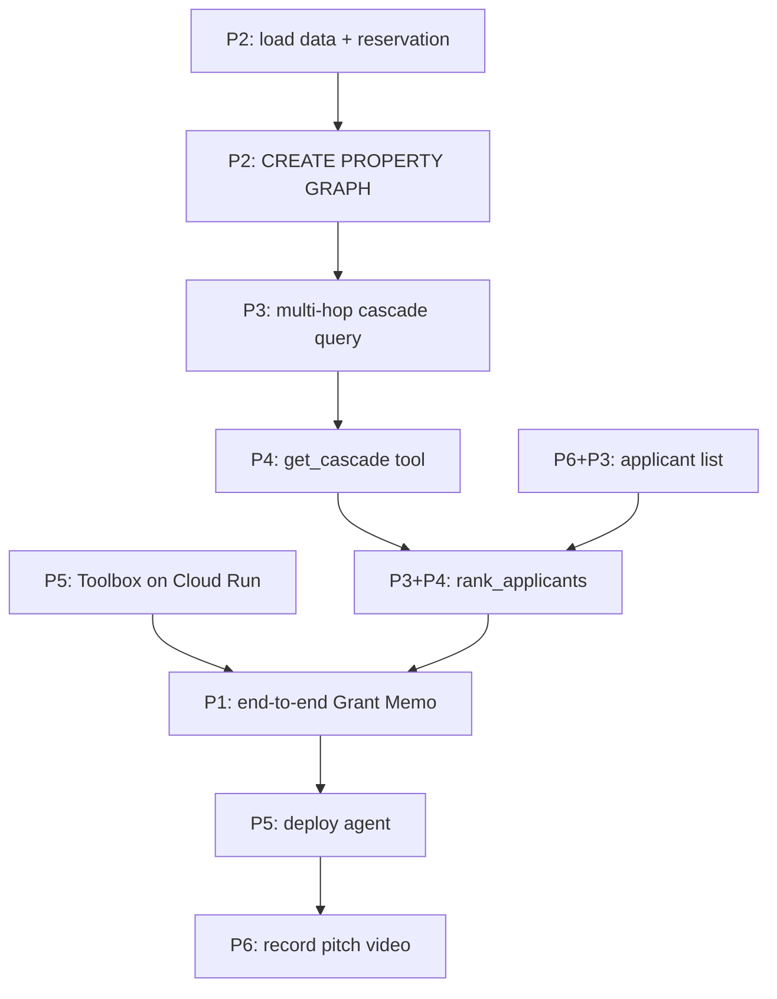

# Team TRT3 — Challenge 3 Team Plan (6 people, 4.5 hours)

> **Repo:** https://github.com/michael-shl/google-hackathon-trt3 · **Team lead:** Michael
> **GCP project (shared, Qwiklabs):** `qwiklabs-gcp-04-7254cc802c4d`. Don't create a new project; work in
> **Cloud Shell** opened from the lab console (local `gcloud` accounts have no access to it).
> **Challenge brief:** [README.md](../README.md) · **Agent requirements:** [agent/README.md](../agent/README.md)
>
> **What we must hand in** (portal: https://portal.angelhack.com/a4i-console): GitHub repo link ·
> Google Skills project link · pitch deck · pitch video (screen-share walkthrough).
> **Judges score only those four things.** Every answer must be visible in the deck or video.

---

## 0. The one-paragraph version

We build an **ADK agent** that a city grant officer hands a **corridor + budget + applicant queue**,
and that returns a **Grant Memo**: which business to fund, how much, the **multi-hop cascade it
protects** (shown via a BigQuery **property graph** `MATCH ... {1,2}` traversal), why not the
runner-up, what we assume, which evidence is modeled, and who the neighborhood is.
Required tech: ADK (Python) · Gemini · BigQuery property graph (genuine multi-hop) · ≥1 custom tool ·
≥1 Google-managed MCP server (MCP Toolbox) · deployed on Cloud Run.

---

## 1. Decisions to lock in the first 20 minutes (Lead runs this)

Write the answers in the team channel and in [decisions.md](decisions.md). **No reopening after T+0:20.**

| # | Decision | Recommended default | Why |
|---|---|---|---|
| D1 | **Corridor** | **Central Market** | Most graph depth (86 businesses with a two-hop cascade) and highest-poverty tracts (22%), so it gives the best cascades and a meaningful equity audit |
| D2 | **Track** | **🏢 Main Street relief** (+ anchor-closure question as stretch) | Clearest user and output for a first-time team; the anchor "backward leg" is a strong stretch add-on |
| D3 | **Scenario sentence** | *"We run relief funding for the Central Market corridor. We have **$50,000** and **11 applications**, and must decide by Friday. Here is who each grant protects, and what we don't know."* | Every design argument resolves faster against one concrete situation |
| D4 | **Traversal depth** | `{1,2}` hops on `Supplies` | README trap #6: `{1,3}` saturates (reaches 200 of 230 businesses) |
| D5 | **Front end** | Start with `adk web`; decide at T+2:00 whether to ship a small "Grant Desk" UI | Judges ask *why* this interface; our user is an internal officer |
| D6 | **MCP server** | **MCP Toolbox** on Cloud Run, `--min-instances=1` | Curated, parameterized read-only tools; no cold start on stage |

> **Honesty note to put in the deck:** the businesses are real; the **11 applications are simulated**
> (we chose real corridor businesses to apply). Say so.

---

## 2. Team roles (6 people)

Fill in names. Each person **owns files**, so we almost never edit the same file (= no merge pain).

| # | Role | Name | Lane / branch | Owns | Core deliverable |
|---|---|---|---|---|---|
| **P1** | **Team Lead & Agent Architect** | Michael | `agent` | `agent/grant_advisor/agent.py`, `prompts.py`, `docs/decisions.md`, `rc/1.0.0` + `main` merges | Root agent + system instruction, integration, decisions, time-keeping |
| **P2** | **Graph Engineer** (data) | | `data` | `sql/0*_*.sql`, BigQuery dataset `a4i_econ` | Data loaded, **property graph created by T+1:00**, validation, `business_tract` + `applicants` tables |
| **P3** | **Cascade & Judgment Analyst** (data) | | `data` | `sql/1*_*.sql`, `agent/grant_advisor/tools/scoring.py`, `tools/audit.py`, `docs/equity_audit.md` | Multi-hop cascade query, weighting/scoring, equity audit, SBA charge-off check |
| **P4** | **Agent Tools Developer** | | `agent` | `agent/grant_advisor/tools/cascade.py`, `tools/memo.py`, `tools/bq.py`, `eval/` | Custom Python tools, Grant Memo builder, refusal behaviors, test questions |
| **P5** | **Platform & Front End** | | `frontend` | `toolbox/`, `frontend/`, Cloud Run services | MCP Toolbox deployed, agent deployed early, demo UI |
| **P6** | **Story & Product** | | `story` | `docs/grant_memo_template.md`, `docs/limitations.md`, deck, video | Scenario, applicant list, memo template, deck, video, **submission** |

Lane mapping to the README's four lanes: **Data** = P2+P3 · **Agent** = P1+P4 · **Front end** = P5 · **Story** = P6.

**Back-ups (if someone is blocked):** P1↔P4, P2↔P3, P5↔P1 (deploy), P6↔P3 (audit numbers).

---

## 3. Architecture we are building



**Split of responsibilities (this is a judged design decision; say it in the deck):**
- **MCP Toolbox (managed MCP server)** = generic, read-only *lookups*: find a business, list
  applicants, neighborhood demographics, loan history, corridor industry mix.
- **Custom Python tools** = the *judgment*: multi-hop cascade + path weighting, ranking with explicit
  assumptions, equity audit, memo assembly.

### Critical path (protect it!)



**Nobody waits:** agent and front-end work start on **mock data** immediately (§6 contracts).

---

## 4. Timeline (T = build start; write real clock times in the right column)

| Time | Phase | Everyone must have… | Clock |
|---|---|---|---|
| **T+0:00–0:20** | **Kickoff** (all, together) | Read §1, lock D1–D6, roles confirmed, GitHub usernames sent to Lead | |
| **T+0:20–0:45** | **Setup** | Cloud Shell open on the team project, repo cloned, own branch created, `adk web` hello agent running (P1, P4, P5) | |
| **T+0:45–1:30** | **Foundations** | P2: graph exists · P3: first multi-hop query · P4: mock tools in `adk web` · P5: Toolbox running locally + hello agent deployed · P6: applicant list + memo template | |
| **⏱ T+1:30** | **Checkpoint 1** (10 min) | Graph ✅ · multi-hop query handed to agent lane ✅ · agent runs with mock tools ✅ · deploy pipeline proven ✅ | |
| **T+1:30–2:45** | **Build** | Real tools wired · scoring v1 · Toolbox on Cloud Run · agent consumes Toolbox · equity audit numbers · UI against mock | |
| **⏱ T+2:45** | **Checkpoint 2 / integration** (15 min) | Deployed agent answers officer questions Q1, Q2, Q7 (§8) on real data and produces a Grant Memo | |
| **T+2:45–3:30** | **Depth & differentiator** | Runner-up comparison, refusals, assumption sensitivity, SBA charge-off check, one stretch item (§10) | |
| **🧊 T+3:30** | **FEATURE FREEZE** | Only bug fixes after this | |
| **T+3:30–4:00** | **Record** | Demo rehearsed 2× on the deployed service, **pitch video recorded**, deck final | |
| **T+4:00–4:15** | **Submit** | All 4 artifacts uploaded **by T+4:15**, 15 min before the deadline | |
| **T+4:15–4:30** | Buffer | — | |

**Stand-ups:** 5 minutes at T+1:30, T+2:45, T+3:30. Format: *done / next / blocked*.
**Blocked > 10 minutes → say it in the channel.** The Lead re-assigns.

---

## 5. Setup instructions (everyone, T+0:20–0:45)

### 5.1 Repo access
1. Everyone: send your GitHub username to Michael → he adds you at
   **Settings → Collaborators** (https://github.com/michael-shl/google-hackathon-trt3/settings/access).
2. Accept the email/GitHub invitation.

### 5.2 Cloud Shell (one shared project per team)
Open the Google Cloud console as your facilitator instructs → click **`>_`** (top right) to open Cloud Shell **for this project**.

```bash
gh auth login                 # HTTPS, log in with browser (or use a personal access token)
git clone https://github.com/michael-shl/google-hackathon-trt3.git   # HTTPS; SSH only works if your key is added to GitHub
cd google-hackathon-trt3
git switch <your-lane>        # data | agent | frontend | story (branches already exist; don't use `git checkout agent`, it clashes with the agent/ folder)
cloudshell workspace .
gcloud config get-value project   # must print qwiklabs-gcp-04-7254cc802c4d
# if not: gcloud config set project qwiklabs-gcp-04-7254cc802c4d
echo 'export PROJECT_ID=qwiklabs-gcp-04-7254cc802c4d' >> ~/.bashrc && source ~/.bashrc
```
Optional but recommended: run **`agy`** (Antigravity CLI) for boilerplate, GQL drafting and deploy scripts. Review diffs (`/diff`) before accepting.

### 5.3 Python env for agent people (P1, P4, P5)
```bash
cd ~/google-hackathon-trt3/agent
python3 -m venv .venv && source .venv/bin/activate
pip install "google-adk[toolbox]" google-cloud-bigquery
```
`agent/grant_advisor/.env` (never commit; see `.gitignore` in §9):
```
GOOGLE_GENAI_USE_VERTEXAI=TRUE
GOOGLE_CLOUD_PROJECT=qwiklabs-gcp-04-7254cc802c4d
GOOGLE_CLOUD_LOCATION=us-central1
BQ_DATASET=a4i_econ
TOOLBOX_URL=http://127.0.0.1:5000
```

### 5.4 Shared-project etiquette (we all have Owner, so we can overwrite each other)
- **Only P2 runs data loads and `CREATE ... PROPERTY GRAPH`.** Anyone else needing a table change asks P2.
- New tables/views: P3 may create `a4i_econ.v_*` views and `a4i_econ.scratch_<name>_*` tables.
- Cloud Run service names: `toolbox`, `grant-advisor`, `grant-desk` (P5 owns all three).
- Secrets: no keys in git, chat screenshots, or slides.

---

## 6. Interface contracts (agree at T+0:45; build against these with mocks)

Every custom tool returns a `dict` with `"status": "success" | "error"`.

```python
def get_cascade(business_id: str, max_hops: int = 2) -> dict:
    """Downstream exposure if this business closes (Supplies edges, multi-hop)."""
    # -> {"status","seed":{business_id,name,naics4,address},
    #     "exposed":[{business_id,name,naics4,hops,path_strength,weakest_link,path_names}],
    #     "counts":{"hop1":int,"hop2":int},"edge_basis":"MODELED (BEA industry rates)"}

def rank_applicants(budget: int = 50000, assumption: str = "base") -> dict:
    """Ranks the applicant queue by protected downstream exposure per grant dollar."""
    # -> {"status","assumptions":{...},"ranking":[{business_id,name,requested,exposure_score,
    #     reach_2hop,tract_poverty,is_hub,recommended_amount,reason}],
    #     "recommendation":{...},"runner_up":{...},"indistinguishable":bool,"sensitivity":[...]}

def equity_audit(funded_ids: list[str]) -> dict:
    """Compares funded businesses' industries and tracts to the corridor."""
    # -> {"status","industry_mix":[{naics4,funded_share,corridor_share,ratio}],
    #     "poverty":{"funded_avg","corridor_avg"},"no_vehicle":{...},"finding":str}

def build_grant_memo(business_id: str, amount: int, runner_up_id: str) -> dict:
    """Assembles the Grant Memo (markdown) from cascade, ranking, neighborhood and audit."""
    # -> {"status","memo_markdown":str,"cascade_dot":str}   # DOT for a small cascade picture
```

MCP Toolbox tools (P5 + P2), names fixed so P1 can write the instruction now:
`find_business(name_query)`, `list_applicants()`, `get_neighborhood(business_id)`,
`get_loan_history(business_id)`, `corridor_industry_mix()`.

---

## 7. Detailed tasks per person

### P1 — Michael, Team Lead & Agent Architect
**T+0:00–0:20**
- [ ] Run kickoff (§1), confirm roles, collect GitHub usernames → add collaborators.
- [ ] Fill in [decisions.md](decisions.md) with D1–D6; keep logging every design choice + *why* (feeds "Rigor & judgment" = 25 pts).

**T+0:20–1:30**
- [ ] Scaffold the ADK package (P4 and P5 then work inside it):
  ```
  agent/grant_advisor/
    __init__.py        # from . import agent
    agent.py           # root_agent
    prompts.py         # INSTRUCTION
    requirements.txt   # google-adk[toolbox], google-cloud-bigquery
    tools/__init__.py, bq.py, cascade.py, scoring.py, audit.py, memo.py   # stubs returning mock data
  ```
  ```python
  # agent/grant_advisor/agent.py
  import os
  from google.adk.agents import Agent
  from google.adk.tools.toolbox_toolset import ToolboxToolset
  from .prompts import INSTRUCTION
  from .tools.cascade import get_cascade
  from .tools.scoring import rank_applicants
  from .tools.audit import equity_audit
  from .tools.memo import build_grant_memo

  tools = [get_cascade, rank_applicants, equity_audit, build_grant_memo]
  if os.getenv("TOOLBOX_URL"):
      tools.append(ToolboxToolset(server_url=os.environ["TOOLBOX_URL"]))

  root_agent = Agent(
      name="grant_advisor",
      model="gemini-flash-latest",       # pin e.g. "gemini-2.5-flash" if the lab requires
      description="Advises a city grant officer on micro-grant allocation using the corridor's supply network.",
      instruction=INSTRUCTION,
      tools=tools,
  )
  ```
  Run from `agent/`: `adk web` → http://localhost:8000 (Cloud Shell: Web Preview → port 8000).
- [ ] Write the system instruction v1 (draft below), refine with P6.

**T+1:30–3:30**
- [ ] Merge lane branches at each checkpoint (PR → `rc/1.0.0`), keep `rc/1.0.0` runnable; PR `rc/1.0.0` → `main` once after freeze.
- [ ] Integration test with P4 using §8 questions; tune instruction from the `adk web` **trace** view.
- [ ] Own the "when do we NOT fund the biggest hub?" answer (judges ask it).
- [ ] Freeze at T+3:30. Be the narrator or the back-up narrator for the video.

**System instruction v1 (starting point):**
```text
You are a grant advisor for a city economic-development officer running micro-grant relief for
the Central Market corridor in San Francisco. The officer has a fixed budget and a queue of
applicants, and must defend every decision in a meeting.

How you work:
1. For "who should we fund", call rank_applicants with the budget. Never rank by connection count.
2. To explain a choice, call get_cascade for the recommended business AND the runner-up, and show
   the paths: names, hop count, and link strength.
3. For neighborhood/need questions, use get_neighborhood (MCP). For loan history, get_loan_history.
4. When asked to write it up, call build_grant_memo and return its markdown unchanged.
5. Use find_business when the officer names a business; confirm the match before analyzing.

Judgment rules:
- A grant changes a closure probability, not an outcome. Always state the assumption you used and
  how the recommendation changes under the alternative assumption.
- Supply and footfall edges are MODELED from federal industry averages; loan edges are REAL (SBA).
  Say this in one line whenever you justify a recommendation.
- If a business has no downstream edges, say the graph cannot show a cascade for it; do not invent one.
- If two applicants are within 10% on exposure, say they are indistinguishable on this evidence and
  name what data would separate them.
- The most connected business is often the most robust; explain when you are NOT funding it.
- Never invent numbers, jobs, or business facts that no tool returned.
```

### P2 — Graph Engineer (critical path: graph by T+1:00)
**T+0:20–0:45 — load data (fast path first so nobody waits)**
- [ ] In Cloud Shell, from the repo root:
  ```bash
  bash scripts/load.sh central-market
  ```
  This loads the 6 tables into `a4i_econ` **and creates the Enterprise reservation** that graph queries require.
- [ ] Then import the notebook in **Colab Enterprise** (README Step 4) and read Sections 6–8 + 12 so you know
  which edges are real vs modeled. **Do not re-run Section 11 (load) unless you tell the team.**

**T+0:45–1:00 — create the property graph** → save as `sql/01_property_graph.sql`
```sql
CREATE OR REPLACE PROPERTY GRAPH a4i_econ.LocalEconomy
  NODE TABLES (
    a4i_econ.businesses
      KEY (business_id)
      LABEL Business PROPERTIES (business_id, name, naics4, zip, address, latitude, longitude),
    a4i_econ.employer_blocks
      KEY (block_id)
      LABEL Employer PROPERTIES (block_id, tract, jobs)
  )
  EDGE TABLES (
    a4i_econ.supplies
      KEY (edge_id)
      SOURCE KEY (supplier_id) REFERENCES businesses (business_id)
      DESTINATION KEY (buyer_id) REFERENCES businesses (business_id)
      LABEL Supplies PROPERTIES (intensity, metres),
    a4i_econ.draws_footfall_from
      KEY (edge_id)
      SOURCE KEY (block_id) REFERENCES employer_blocks (block_id)
      DESTINATION KEY (business_id) REFERENCES businesses (business_id)
      LABEL DrawsFootfall PROPERTIES (worker_share, metres)
  );
```
Traps (from notebook §13): unbackticked `a4i_econ.x` in NODE/EDGE TABLES, bare table name in `REFERENCES`;
property names are global and types must agree; check the URL says `/bigquery/` when googling.
If you see *"require a reservation with Enterprise…"*, wait 1 minute and retry.

- [ ] Smoke test and **post the result in the channel**:
  ```sql
  GRAPH a4i_econ.LocalEconomy
  MATCH (seed:Business)-[:Supplies]->{1,2}(exposed:Business)
  RETURN seed.name AS business, seed.naics4 AS industry,
         COUNT(DISTINCT exposed.business_id) AS exposed_2hop
  NEXT
  FILTER exposed_2hop >= 5 AND exposed_2hop <= 25
  RETURN business, industry, exposed_2hop
  ORDER BY exposed_2hop DESC
  ```

**T+1:00–1:45 — supporting tables** (`sql/02_business_tract.sql`, `sql/03_applicants.sql`)
- [ ] Map each business to its census tract (the `businesses` table has no tract column):
  ```sql
  CREATE OR REPLACE TABLE a4i_econ.business_tract AS
  SELECT b.business_id, t.geo_id AS tract
  FROM a4i_econ.businesses b
  JOIN `bigquery-public-data.geo_census_tracts.us_census_tracts_national` t
    ON ST_CONTAINS(t.tract_geom, ST_GEOGPOINT(b.longitude, b.latitude))
  WHERE t.state_fips_code = '06';
  -- verify: column names (tract_geom, geo_id) and that tract ids match tract_demographics.geo_id (11 chars)
  ```
- [ ] Create `a4i_econ.applicants (business_id STRING, requested_amount INT64, stated_need STRING)`
  from the list P3+P6 choose.
- [ ] Run the notebook's **validation section (12)** and screenshot the result for the deck (duplicate-key check!).

**T+1:45–3:30**
- [ ] Support P5 with Toolbox SQL statements (§7 P5); support P3 with queries.
- [ ] Stretch: **anchor-closure** query (forward `DrawsFootfall`, then backward `<-[:Supplies]-`).

### P3 — Cascade & Judgment Analyst
**T+0:20–1:00**
- [ ] Read notebook §2 ("the wrong answer"), §7 (supply edges), §13 ("what is yours to decide").
- [ ] With P6, choose the **11 simulated applicants** from real corridor businesses, as a deliberate mix:
  2 big hubs · 5 mid-band (5–25 exposed at 2 hops) · 3 leaves (no cascade) · 1 with an SBA loan record.
  Requested amounts $5k–$25k, total ≈ $130–150k (over budget on purpose).

**T+1:00–1:30 — the cascade query (hand to P4 by T+1:15)** → `sql/10_cascade.sql`
```sql
GRAPH a4i_econ.LocalEconomy
MATCH (seed:Business WHERE seed.business_id = @seed_id)
      -[e:Supplies]->{1,2}(exposed:Business)
WHERE seed != exposed
LET hops = ARRAY_LENGTH(e),
    path_strength = EXP(SUM(LN(e.intensity))),   -- product of intensities along the path
    weakest_link = MIN(e.intensity)
RETURN exposed.business_id AS business_id, exposed.name AS name, exposed.naics4 AS naics4,
       hops, path_strength, weakest_link
```
(`e` is a *group variable*; `SUM`/`MIN` on it is BigQuery "horizontal aggregation". If `LET` with several
definitions errors, use one `LET` per line. Multiple paths can reach the same business → keep the max strength.)

**T+1:30–2:45 — scoring v1** (`tools/scoring.py`, pair with P4). This is a proposed default; change it if you can defend something better:
- `exposure(a) = Σ over distinct exposed x of max path_strength(a→x)` (Supplies, ≤2 hops).
- `need(a)` = poverty rate of the applicant's tract (+ average over exposed businesses' tracts).
- **Hub rule:** top-5% by out-degree are flagged `is_hub`; assume a grant moves their closure probability
  less (they are robust) → that's how we "don't fund the hub every time".
- **Money assumption (state it!):** `base`: a grant equal to the request cuts 12-month closure risk by 10 pts;
  `pessimistic`: 5 pts; `optimistic`: 20 pts. Score = exposure × Δp ÷ amount, need as tie-breaker.
- Output **sensitivity**: does the #1 change across assumptions / product-vs-weakest-link weighting? Report it.
- `indistinguishable = True` when top-2 are within 10%.

**T+2:45–3:30 — rigor deliverables** (`docs/equity_audit.md`, numbers go in the deck)
- [ ] **Equity audit:** funded industries vs corridor mix (ratio), funded tracts' poverty & no-vehicle rate vs corridor average.
  Explicitly test the known bias: restaurants/light manufacturing over-represented vs personal services?
- [ ] **Ground-truth check:** compare businesses our model calls fragile/exposed with SBA `charged_off = TRUE` loans
  (`a4i_econ.borrowed_from`). Even "only N records, here's what they show" is a strong slide.

### P4 — Agent Tools Developer
**T+0:20–1:15**
- [ ] Get the hello agent working in `adk web`, then implement **mock** versions of all 4 tools (§6 shapes) so P1 & P5 can work.
- [ ] Shared BigQuery helper:
  ```python
  # agent/grant_advisor/tools/bq.py
  import os
  from google.cloud import bigquery

  _client = None
  DATASET = os.getenv("BQ_DATASET", "a4i_econ")

  def run(sql: str, **params) -> list[dict]:
      global _client
      _client = _client or bigquery.Client(project=os.getenv("GOOGLE_CLOUD_PROJECT"))
      types = {str: "STRING", int: "INT64", float: "FLOAT64", bool: "BOOL"}
      qp = [bigquery.ScalarQueryParameter(k, types[type(v)], v) for k, v in params.items()]
      job = _client.query(sql, job_config=bigquery.QueryJobConfig(query_parameters=qp))
      return [dict(r) for r in job.result()]
  ```

**T+1:15–2:45 — real tools**
- [ ] `get_cascade`: wrap P3's query. `max_hops` can't be a query parameter → validate `1 <= max_hops <= 3`
  and format it into `{1,N}`. Aggregate per exposed business (min hops, max strength), sort by strength,
  cap the list (~25) so the LLM context stays small. Return `"status":"error"` instead of raising.
- [ ] `build_grant_memo`: fill `docs/grant_memo_template.md` (from P6) with cascade + ranking + neighborhood
  + audit; also return a small **Graphviz DOT** string of the top paths (for the UI).
- [ ] Keep tool docstrings precise: the model only knows what the docstring says.

**T+2:45–3:30**
- [ ] Run `eval/officer_questions.md` (§8) against the deployed agent; log ✅/❌ and fix.
- [ ] Refusal cases: leaf applicant, indistinguishable pair, budget can't save anyone, unknown business name.

### P5 — Platform & Front End
**T+0:20–1:00 — MCP Toolbox locally** (`toolbox/tools.yaml`; Toolbox v1.x multi-document format)
```yaml
kind: source
name: bq
type: bigquery
project: ${PROJECT_ID}
location: US
---
kind: tool
name: find_business
type: bigquery-sql
source: bq
description: Find corridor businesses by (partial) name. Returns id, name, address and 4-digit NAICS industry.
parameters:
  - name: name_query
    type: string
    description: Part of the business name, e.g. "roasters".
statement: |
  SELECT business_id, name, address, naics4
  FROM a4i_econ.businesses
  WHERE LOWER(name) LIKE CONCAT('%', LOWER(@name_query), '%')
  LIMIT 10
---
kind: tool
name: get_neighborhood
type: bigquery-sql
source: bq
description: Census tract demographics (poverty, no-vehicle and public-assistance rates) where a business is located.
parameters:
  - name: business_id
    type: string
    description: The business_id from find_business or list_applicants.
statement: |
  SELECT bt.tract, d.total_pop, d.median_income, d.poverty_rate, d.no_vehicle_rate, d.assistance_rate
  FROM a4i_econ.business_tract bt
  JOIN a4i_econ.tract_demographics d ON d.geo_id = bt.tract
  WHERE bt.business_id = @business_id
---
kind: toolset
name: grant_toolset
tools:
  - find_business
  - get_neighborhood
```
Add `list_applicants`, `get_loan_history`, `corridor_industry_mix` the same way (SQL from P2).
**Read-only curated tools only, no free-form `execute_sql`.** Run locally:
```bash
export PROJECT_ID=qwiklabs-gcp-04-7254cc802c4d
npx @toolbox-sdk/server --config toolbox/tools.yaml     # serves on 127.0.0.1:5000
```

**T+1:00–1:30 — prove the deploy pipeline early** (hello agent first, real agent later)
```bash
cd agent
adk deploy cloud_run --project $PROJECT_ID --region us-central1 \
  --service_name grant-advisor --with_ui ./grant_advisor
# check flags with: adk deploy cloud_run --help
```

**T+1:30–2:15 — Toolbox on Cloud Run.** **Preferred: `terraform apply` in [`terraform/`](../terraform/README.md)**. It enables the APIs,
creates the service accounts + IAM, uploads `toolbox/tools.yaml` as a secret, deploys `toolbox` (min instances 1), and prints the
exact `adk deploy` command. Manual equivalent (docs: https://mcp-toolbox.dev/documentation/deploy-to/cloud-run/):
```bash
gcloud services enable run.googleapis.com cloudbuild.googleapis.com artifactregistry.googleapis.com \
  iam.googleapis.com secretmanager.googleapis.com
gcloud iam service-accounts create toolbox-identity
for r in roles/secretmanager.secretAccessor roles/bigquery.jobUser roles/bigquery.dataViewer; do
  gcloud projects add-iam-policy-binding $PROJECT_ID \
    --member serviceAccount:toolbox-identity@$PROJECT_ID.iam.gserviceaccount.com --role $r; done
sed "s/\${PROJECT_ID}/$PROJECT_ID/" toolbox/tools.yaml > /tmp/tools.yaml
gcloud secrets create tools --data-file=/tmp/tools.yaml   # later: gcloud secrets versions add tools --data-file=/tmp/tools.yaml
gcloud run deploy toolbox \
  --image us-central1-docker.pkg.dev/database-toolbox/toolbox/toolbox:latest \
  --service-account toolbox-identity --region us-central1 \
  --set-secrets "/app/tools.yaml=tools:latest" \
  --args="--config=/app/tools.yaml","--address=0.0.0.0","--port=8080" \
  --min-instances=1 --allow-unauthenticated
```
> `--allow-unauthenticated` is our hackathon trade-off: the tools are fixed, read-only queries over public data.
> Production version: drop it, grant the agent's service account `roles/run.invoker`, and use
> `CredentialStrategy.workload_identity(target_audience=TOOLBOX_URL)` in `ToolboxToolset`. Say this in the deck.

- [ ] Redeploy the real agent at T+2:30 and set env vars + warm instance:
  ```bash
  gcloud run services update grant-advisor --region us-central1 --min-instances=1 \
    --update-env-vars TOOLBOX_URL=<toolbox-url>,GOOGLE_GENAI_USE_VERTEXAI=TRUE,GOOGLE_CLOUD_LOCATION=us-central1,BQ_DATASET=a4i_econ
  ```
  Ensure the agent's service account can use BigQuery (`jobUser`, `dataViewer`) and Vertex AI (`aiplatform.user`).

**T+2:00 decision (with P1): front end**
- Option A (default): ship `adk web` on Cloud Run and **defend it**: our user is an internal grant officer.
- Option B (if core works by T+2:30): small **Grant Desk** Streamlit page: applicant queue on the left, memo + cascade
  picture (`st.graphviz_chart(cascade_dot)`) on the right, calling the deployed agent's API
  (see `<agent-url>/docs` for `/run`). Build it against a mocked response from T+1:30, swap at T+2:45.
- Show **one** cascade, not the whole corridor (hairball + 2 MB visualization cap).

### P6 — Story & Product (starts at minute zero)
**T+0:00–1:00**
- [ ] Write the scenario sentence (D3) on slide 1 and in [decisions.md](decisions.md).
- [ ] Pick the 11 applicants with P3; write a one-line "stated need" for each.
- [ ] Create `docs/grant_memo_template.md` with all 7 required sections:
  1. **Which business** (name, address) and **how much**
  2. **What it protects**: named cascade, hop distance, link strength
  3. **The traversal itself, shown** (picture or path list)
  4. **Why this one and not the runner-up**
  5. **What we are assuming** (what the grant changes) + how the answer moves if wrong
  6. **Which evidence is modeled**: one honest line
  7. **Who the neighborhood is**: tract demographics
- [ ] Write `docs/limitations.md`: modeled edges, tract-level footfall, applications simulated, no per-business jobs data, etc.

**T+1:00–3:30**
- [ ] Deck (6–7 slides, front-loaded): Problem & scenario · What the agent does · **Demo cascade** ·
  Architecture (graph + MCP + custom tools + Cloud Run) · **Rigor**: real vs modeled, validation, equity audit
  numbers, "when we don't fund the hub" · Limitations & next steps (intake agent).
- [ ] Demo script: exact prompts in order (use §8 Q1 → Q2 → Q7), expected outputs, screenshot fallbacks.
- [ ] Collect numbers from P3 (audit, charge-off check) and screenshots from P2 (validation, graph).

**T+3:30–4:15**
- [ ] Record the **pitch video** (screen share of the deployed agent + narration; 2 takes, keep the best).
- [ ] Time the pitch out loud. **Submit all 4 artifacts by T+4:15** and post the confirmation in the channel.

---

## 8. Officer questions = our test suite (`eval/officer_questions.md`, P4 + P6)

| # | Officer asks | Expected agent behavior | Tools |
|---|---|---|---|
| Q1 | "I have $50,000 and these 11 applications. If I fund nobody, which closure does the most damage?" | Ranking by protected exposure, not connection count; states assumption | `rank_applicants` |
| Q2 | "Show me why #1 and not #2." | Both cascades side by side: names, hops, strength | `get_cascade` ×2 |
| Q3 | "Are any of #1's downstream businesses already fragile?" | Loan/charge-off evidence, or "no evidence in data" | `get_cascade`, `get_loan_history` |
| Q4 | "Nobody at the far end of that chain applied. Should they have?" | Names unapplied exposed businesses (stretch: anchor leg) | `get_cascade` |
| Q5 | "What does $8,000 actually change?" | Admits data can't answer; states assumption + sensitivity | `rank_applicants(assumption=…)` |
| Q6 | "Whose neighborhood does this help?" | Tract poverty / no-vehicle vs corridor | `get_neighborhood`, `equity_audit` |
| Q7 | "Write it up. I present Friday." | Full Grant Memo, all 7 sections | `build_grant_memo` |
| R1 | Ask about a leaf business | "No downstream cascade visible in the graph", with no invention | `get_cascade` |
| R2 | "Why not fund the biggest hub?" | Robustness argument with numbers | `rank_applicants` |

---

## 9. Git workflow

- Branches: `data` (P2, P3) · `agent` (P1, P4) · `frontend` (P5) · `story` (P6). Commit small, push often.
- **`rc/1.0.0` is the integration branch and must always run.** Lanes merge into it via PR at checkpoints
  (T+1:30, T+2:45, T+3:30); P1 merges. **`main` changes once**: one PR `rc/1.0.0` → `main` after the
  feature freeze, then submit the repo link.
  ```bash
  git add -A && git commit -m "feat(agent): get_cascade wraps 2-hop GQL"
  git pull origin <branch>          # teammate's commits on the same lane
  git pull origin rc/1.0.0          # other lanes' merged work (merge, don't rebase pushed commits)
  git push -u origin <branch>
  gh pr create --fill --base rc/1.0.0
  ```
- Two people on one branch (`data`, `agent`): you own different files (§2) → pull before push.
- Add to `.gitignore` (P1, first commit): `.venv/`, `.env`, `**/.env`, `__pycache__/`.
- Judges read the repo: keep the top of `README.md` updated (P6) with track, corridor, how to run, architecture.

---

## 10. Differentiators: pick **one** at T+2:45 (Lead decides)

| Option | Owner | Why judges care |
|---|---|---|
| **SBA charge-off ground-truth check** (recommended) | P3 | The only real failure data in the challenge; "almost nobody will notice" |
| **Anchor-closure leg** (footfall forward, supply backward) | P2 + P4 | Finds businesses that never applied; shows GQL direction change |
| **Budget split** ($50k into 1 vs 5 grants) | P3 + P4 | "The graph has an opinion and it is not obvious" |
| **Second-order case** (fund A, assume B fails anyway) | P3 | Few teams attempt it |
| **Intake agent** (owner describes suppliers → new edges) | P1 + P4 | Closes our stated data limitation; only if everything else is done |

---

## 11. Risks & fallbacks

| Risk | Fallback |
|---|---|
| Graph query: *"requires a reservation with Enterprise…"* | Wait 1 min after `load.sh`; re-run `bash scripts/load.sh central-market` (idempotent) |
| Notebook / federal endpoints fail | `scripts/load.sh` snapshot is already the primary path |
| `CREATE PROPERTY GRAPH` errors on `REFERENCES` | Check NODE TABLES naming first (trap #1) |
| Toolbox Cloud Run deploy stuck | Run Toolbox locally + agent locally for the video; keep trying deploy in parallel |
| Agent Cloud Run deploy fails | Record video from `adk web` in Cloud Shell; note deploy status honestly |
| Quota / 429 from Gemini | Use flash model, shorten tool outputs, retry; don't re-run long demos |
| Cold start on stage/video | `--min-instances=1` on both services; send a warm-up request before recording |
| Running late | Cut in this order: custom UI → differentiator → Q4/Q5 polish. **Never cut: Grant Memo, multi-hop traversal, deploy, video** |

---

## 12. Judging checklist (P6 verifies before submitting)

- [ ] **Impact (30):** Grant Memo is specific (name, address, amount, protected businesses), usable on Friday.
- [ ] **Technical (30):** video shows the multi-hop `MATCH ... {1,2}` (query + trace view), MCP Toolbox call, custom tool, Cloud Run URL.
- [ ] **Rigor (25):** real vs modeled edges stated · validation section result · equity audit **numbers** · industry bias found ·
  "when we don't fund the hub" · assumptions + sensitivity · limitations slide.
- [ ] **Craft (15):** pitch fits the time, demo works, interface choice justified ("internal officer tool").
- [ ] **Bonus (+10):** differentiator from §10 that serves the solution.
- [ ] Track (Main Street) and corridor (Central Market) stated in the **first 20 seconds**.
- [ ] Submitted: repo link · Google Skills project link · deck · pitch video.

---

## 13. Reference

- Challenge brief: [../README.md](../README.md) · notebook §13 traps: `notebooks/c3_01_load_explore.ipynb`
- BigQuery Graph: https://docs.cloud.google.com/bigquery/docs/graph-overview · query: https://docs.cloud.google.com/bigquery/docs/graph-query-overview
- ADK: https://adk.dev · ADK + Toolbox: https://adk.dev/integrations/mcp-toolbox-for-databases/
- MCP Toolbox: https://mcp-toolbox.dev · BigQuery SQL tool: https://mcp-toolbox.dev/integrations/bigquery/tools/bigquery-sql/
- Help: table captain → ROI facilitator → event Discord. For data/notebook issues, run the notebook's diagnostic cell (Appendix A) and share its output.
